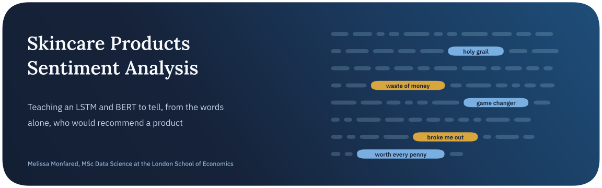
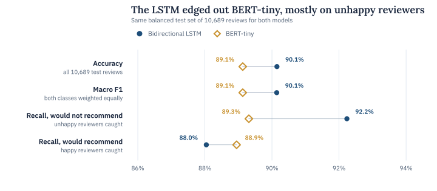
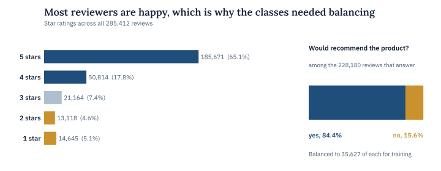
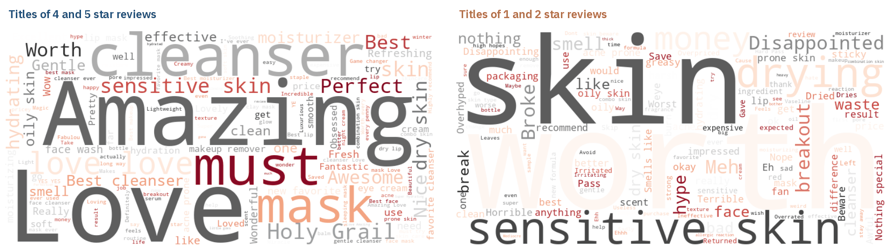
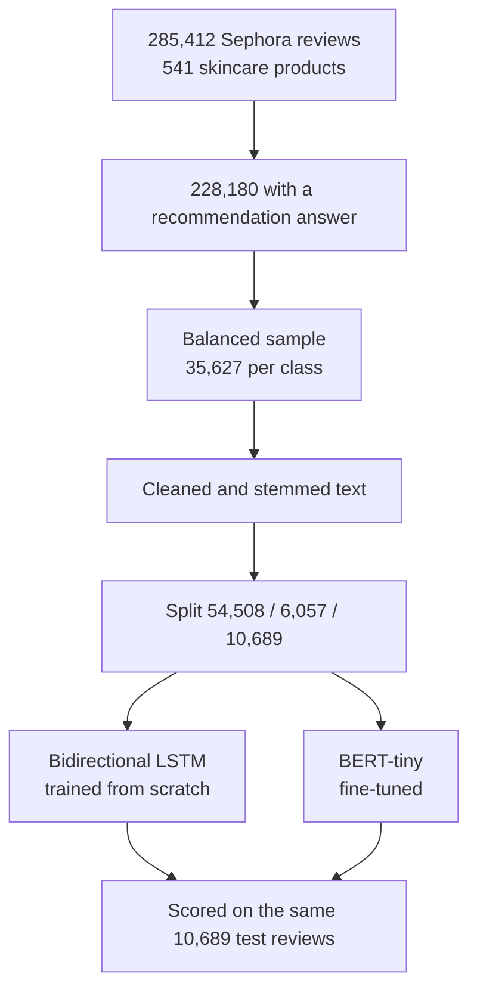

<p align="center">
  
</p>

<p align="center">
  <a href="https://www.kaggle.com/code/melissamonfared/skincare-products-eda-sentiment-analysis"></a>
  
  
  
</p>

Sephora shoppers leave long, specific reviews, and most of them also answer a simple yes or no question, whether they would recommend the product. This project asks whether a model can predict that answer from the review text alone.

The work grew out of my bachelor’s thesis at Amirkabir University of Technology. The notebook explores 285,412 skincare reviews and the products behind them, then compares a bidirectional LSTM trained from scratch with a fine-tuned BERT-tiny on the same held-out reviews.

> **In short.** Both models read the recommendation correctly about nine times in ten. The bidirectional LSTM reached 90.1% accuracy on 10,689 balanced test reviews against 89.1% for BERT-tiny, and most of its edge came from catching unhappy reviewers, 92.2% of them against 89.3%.

## Key findings

| Finding | Evidence |
| :-- | :-- |
| The text alone predicts the recommendation well | 90.1% accuracy for the bidirectional LSTM and 89.1% for BERT-tiny on 10,689 held-out reviews, half of them positive |
| The LSTM is better at spotting unhappy customers | It caught 92.2% of reviewers who would not recommend the product against 89.3% for BERT-tiny, which in turn did slightly better on happy reviewers (88.9% against 88.0%) |
| Happy reviewers dominate the raw data | 65.1% of the reviews give five stars and 84.4% of reviewers who answered would recommend the product, so training used a balanced sample of 35,627 reviews per class |
| Star rating and recommendation mostly agree | The two correlate at 0.84, which is why the recommendation works as a sentiment label without the ambiguity of three-star reviews |
| Unhappy reviewers write about money and skin reactions | “Worth”, “money”, “waste”, “drying” and “breakout” stand out in the titles of one- and two-star reviews |
| Happy reviewers write about favourites and skin types | “Holy grail”, “must”, “perfect” and “sensitive skin” lead the titles of four- and five-star reviews |

<picture>
  <source media="(prefers-color-scheme: dark)" srcset="assets/results-dark.svg">
  
</picture>

## Conclusion

A shopper’s recommendation is largely readable from the words they use. Both models get to about 90% on balanced data, and they do it with modest capacity, a 2.1-million-parameter LSTM and the smallest BERT variant there is.

BERT-tiny didn’t beat the LSTM here, and the setup suggests why. It was fine-tuned on text that had already been stemmed and stripped of stopwords, while a pretrained transformer learned its vocabulary and its sense of context from natural sentences. Feeding it the raw reviews is the first thing I’d change.

For a retailer, the LSTM’s strength is the useful one. Catching 92% of the customers who would not recommend a product makes it a sensible first filter for sending negative feedback to a person.

## Used by others

The Kaggle version of this notebook is listed as a suggested dataset for student projects in a [University of Catania course](https://www.dmi.unict.it/tramonta/sdm/L11_ProgettiProposti.pdf) (November 2025) and is cited as earlier work by the independent [Hype vs. Hyperpigmentation](https://tanvividyala.github.io/hype-vs-hyperpigmentation) analysis.

## The data

The data is the Sephora products and skincare reviews dataset on Kaggle, scraped from the Sephora website in March 2023. The notebook combines five review files into 285,412 reviews of 541 products from 100 brands and merges them with product details such as price and ingredients.

Each review’s label is the reviewer’s own answer to whether they would recommend the product. Positive reviews were randomly downsampled to match the 35,627 negative ones, which gives 71,254 reviews in total. The final split holds out 10,689 of them for testing and 6,057 for validation. Before modelling, the text is lowercased and stripped of HTML and anything that isn’t a letter, then Porter-stemmed with English stopwords removed.

<picture>
  <source media="(prefers-color-scheme: dark)" srcset="assets/ratings-dark.svg">
  
</picture>



*The most frequent words in review titles, split by star rating. Price and skin reactions dominate the complaints.*

## The models



| Model | Set-up |
| :-- | :-- |
| Bidirectional LSTM | A 128-dimensional embedding over a 15,000-word vocabulary, two bidirectional LSTM layers of 64 units, spatial dropout of 0.4 and a 32-unit dense layer with L1 and L2 penalties, inputs cut to 64 tokens, 2.1 million parameters, Adam with early stopping |
| BERT-tiny | prajjwal1/bert-tiny fine-tuned for two classes with AdamW at a learning rate of 2e-5, batches of 128 and inputs cut to 64 tokens, stopped early at epoch 15 |

<details>
<summary><b>Full test results for both models</b></summary>
<br>

| Metric | Bidirectional LSTM | BERT-tiny |
| :-- | --: | --: |
| Accuracy | 90.1% | 89.1% |
| Macro F1 | 0.901 | 0.891 |
| Precision, would recommend | 91.8% | 89.2% |
| Recall, would recommend | 88.0% | 88.9% |
| Precision, would not recommend | 88.6% | 89.1% |
| Recall, would not recommend | 92.2% | 89.3% |
| Unhappy reviewers missed | 417 | 574 |
| Happy reviewers missed | 636 | 588 |

All figures come from the confusion matrices on the same 10,689 test reviews.

</details>

## Limitations and next steps

The test set is balanced, while in the full data about 84% of reviewers recommend the product. On that natural mix, precision on the negative class would be noticeably lower than the numbers above. The reviews also repeat themselves, with roughly 245,000 unique texts among 285,000 reviews, so a split that keeps identical texts together would give a cleaner estimate. Stopword removal also throws away negations such as “not” and “don’t”, which carry a lot of sentiment.

Next I want to fine-tune BERT on the raw review text and keep negations during cleaning. Reporting results on the natural class balance would then show how the models behave in practice.

## Running it

The quickest way is to [open the notebook on Kaggle](https://www.kaggle.com/code/melissamonfared/skincare-products-eda-sentiment-analysis), where the dataset is already attached. To run it locally, download the Sephora products and skincare reviews data from Kaggle and change the file paths in the data-loading cells to point at your copy.

```bash
pip install pandas numpy matplotlib seaborn nltk wordcloud beautifulsoup4 rich scikit-learn tensorflow torch transformers
jupyter notebook skincare-products-eda-sentiment-analysis.ipynb
```

## Repository

```text
.
├── skincare-products-eda-sentiment-analysis.ipynb   product and review analysis, the LSTM and BERT-tiny
├── assets/                                          figures used in this README
└── README.md
```

## About

Made by Melissa Monfared, MSc Data Science at the London School of Economics. More projects live on [my website](https://melissamonfared.github.io). I also post notebooks on [Kaggle](https://kaggle.com/melissamonfared) and I’m on [LinkedIn](https://linkedin.com/in/melissamonfared).

Data from the Sephora products and skincare reviews dataset on Kaggle.
